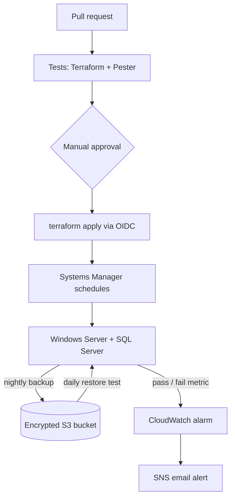

# SQL Server Backup Pipeline on AWS

Automated nightly SQL Server backups to Amazon S3 that are **restore-tested every day**, with CloudWatch alerts on failure — all built with Terraform and deployed through an approval-gated GitHub Actions pipeline that logs into AWS with OIDC (no stored keys).


## Architecture



## How it works

| Time (UTC) | What happens |
|---|---|
| 23:00 | **Backup** — `Backup-Database.ps1` backs up the `AdventureWorksLT` database with checksums and uploads it to S3 |
| 23:30 | **Restore test** — `Test-Restore.ps1` downloads the newest backup, restores it as a separate test database, runs `DBCC CHECKDB`, compares row counts with the live database, then cleans up |
| After each run | Each script publishes `BackupSuccess` / `RestoreTestSuccess` (1 = pass, 0 = fail) to CloudWatch |
| Any failure **or missed run** | CloudWatch alarm → SNS → email |

Both scripts run on the server through **AWS Systems Manager State Manager**. Terraform reads the scripts straight from this repo, so the repo is the single source of truth.

## CI/CD pipeline

| Trigger | Jobs |
|---|---|
| Every pull request | `terraform fmt -check`, `terraform validate`, PSScriptAnalyzer, and Pester tests |
| Merge to `main` | Tests run again → pipeline **pauses for manual approval** (GitHub `production` environment) → logs into AWS with **OIDC** → `terraform plan` → `terraform apply` of that exact plan |

Changing a PowerShell script and merging it is how a new version gets deployed to the server.

## Design decisions

- **No inbound ports.** The security group has zero inbound rules. I connect and run commands through Systems Manager instead of RDP.
- **Least-privilege IAM.** The server can upload and read backups but **cannot delete them**, and can only publish metrics to its own CloudWatch namespace. A compromised server can't wipe its own backups.
- **Encrypted everywhere.** EBS volume and S3 bucket are encrypted at rest; all AWS traffic uses HTTPS.
- **S3 protections.** Versioning, all public access blocked, and a 30-day lifecycle rule for retention.
- **IMDSv2 required** on the EC2 instance.
- **Keyless deployments.** GitHub Actions uses OIDC to get temporary AWS credentials. The IAM trust policy only accepts tokens from this repo's `production` environment.
- **Remote state.** Terraform state lives in an encrypted, versioned S3 bucket with state locking, so my laptop and the pipeline share one source of truth.
- **Missing data counts as failure.** If a backup doesn't run at all, the alarm still fires.
- **Cost.** A public subnet instead of a NAT gateway (~$32/month saved); the server is stopped when not in use.

## Challenges I solved

1. **SQL Server install failed silently.** I read the setup logs (`Summary.txt`, then `Detail.txt`) and found a `CryptographicException`: the Session Manager user's profile wasn't loaded. Fixed by running the installer as SYSTEM through SSM Run Command.
2. **S3 upload failed after a successful backup.** The SqlServer and AWS PowerShell modules clash in one PowerShell process (`System.IO.Pipelines`). Fixed by running AWS calls in a separate PowerShell process.
3. **A `terraform plan` wanted to destroy the server.** Amazon's monthly Windows image update changed the AMI ID. I caught it in the plan and added `ignore_changes = [ami]` so the server is patched in place, not rebuilt.
4. **The OIDC login was rejected.** My repo uses GitHub's immutable subject format (account and repo IDs in the token), so I updated the IAM trust policy to match.
5. **The pipeline kept redeploying unchanged scripts.** Windows (CRLF) vs. Linux (LF) line endings made the same file look different. I normalized line endings in Terraform.

## Known limitations

- Scheduled jobs only run while the server is on; I stop it to save money, so the alarm fires on days it's off.
- The pipeline's IAM role uses `AdministratorAccess` because Terraform manages IAM, EC2, S3, and more. The trust policy (approved `production` environment only) is the guard; a production setup would scope this down.
- `Install-SqlServer.ps1` and `Restore-Database.ps1` are written for full disaster recovery, but a timed recovery drill hasn't been run yet.

## Tech stack

AWS (EC2, S3, IAM, VPC, Systems Manager, CloudWatch, SNS) · Terraform · PowerShell · SQL Server · Windows Server 2022 · GitHub Actions · Pester · OIDC

## Repository layout

```
.github/workflows/ci.yml   CI/CD pipeline
scripts/                   PowerShell scripts that run on the server
terraform/                 All AWS infrastructure
tests/                     Pester tests for the scripts
```
